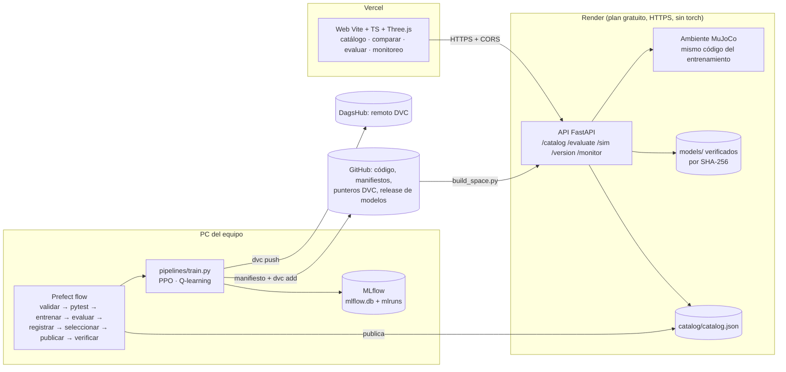

# Robot Expedition

Un rover en Marte debe **visitar la baliza 1, luego la baliza 2 y volver a la
base antes de agotar la batería**, sin caer en la grieta ni volcar.

- **Física:** MuJoCo en 3D (gravedad de Marte, dunas, una grieta real, rocas y
  ruedas con motor).
- **Vista:** Three.js.
- **Contexto:** proyecto final de MLOps (Universidad Externado). Equipo:
  Suleily, Tomás, Natalia y Nicol.

| | |
|---|---|
| Web del docente (Vercel) | <https://web-five-gules-83.vercel.app> |
| API (FastAPI, HTTPS) | `https://robot-expedition-api.onrender.com` (ver [Despliegue](#despliegue)) |
| Ficha del ambiente y niveles | [docs/ambiente-v1.md](docs/ambiente-v1.md) |
| Experimentos y decisiones | [docs/experimentos.md](docs/experimentos.md) |
| Escenarios variados y generalización | [docs/escenarios-variados.md](docs/escenarios-variados.md) |
| Campaña planetaria de diez escenarios | [docs/simulador-planetario.md](docs/simulador-planetario.md) |
| Contrato planetario y episodios | [docs/contratos-planetario.md](docs/contratos-planetario.md) |
| Incidente y rollback | [docs/incidente.md](docs/incidente.md) · [docs/evidencia/rollback.md](docs/evidencia/rollback.md) |
| Informe y guion de defensa | [docs/informe.md](docs/informe.md) · [docs/guion-defensa.md](docs/guion-defensa.md) |
| Contratos (observación, manifiesto, catálogo y API) | [docs/contratos.md](docs/contratos.md) |
| Checklist de entrega | [docs/checklist-entrega.md](docs/checklist-entrega.md) |

## Arquitectura



**Una sola autoridad para la física:** la API usa el mismo ambiente Python
que el entrenamiento y la suite de evaluación (`pipelines/`). La web no simula
nada; solo dibuja los cuadros que devuelve la API.

## Instalación

Usa Python **3.12**, torch CPU y Node **26** (para la web).

```bash
python3.12 -m venv .venv && source .venv/bin/activate        # Windows: py -3.12 -m venv .venv ; .\.venv\Scripts\Activate.ps1
python -m pip install --upgrade pip
python -m pip install torch==2.15.0 --index-url https://download.pytorch.org/whl/cpu
python -m pip install -r requirements.txt
python -m pytest -q                                          # 80 pruebas
```

Las variables están en [`.env.example`](.env.example); cópialo como `.env`.
Ninguna es secreta salvo las credenciales de DVC y DagsHub, que solo van en
`.env` local o como secretos del Space.

## Campaña planetaria de diez escenarios

La ampliación planetaria usa **diez mapas fijos** (`scenario_01`…`scenario_10`),
misiones de recolección explícita, PPO con cuatro observaciones de historial y un
currículo que solo avanza mediante evaluaciones independientes. Conserva todos
los intentos completos en SQLite y permite reproducirlos y comparar rutas.

```bash
python scripts/campaign.py validate --physical --output logs/campaign-validation.json
python pipelines/train.py --config configs/experiments/exp-007-planetary.yaml --seed 1
python scripts/episodes.py history scenario_08
```

**Guía de ejecución, entrenamiento, checkpoints, replay y evaluación:**
[docs/campana-diez-escenarios.md](docs/campana-diez-escenarios.md).
El contrato planetario es v2; los modelos anteriores de balizas siguen separados.
La prueba física y los runs cortos verifican funcionamiento, no dominio aprendido.


## Recuperar los modelos y reproducir una evaluación

Sin cuentas ni credenciales:

```bash
curl -LO https://github.com/nataliariosmoreno11-dev/robot_expedition/releases/download/models-v2/robot-expedition-models-v2.zip
python -m zipfile -e robot-expedition-models-v2.zip .        # models/<run_id>/ + manifests/ + SHA256SUMS.txt
sha256sum -c SHA256SUMS.txt                                  # o: python scripts/package_models.py lo genera
# Reevaluar un run del catálogo (por ejemplo, el primer Q-learning) con la suite fija de N2:
python pipelines/evaluate.py --policy qlearning --model models/4d91d98f05b248cfaa699285cc7680f0/qlearning.npz --level n2
python pipelines/evaluate.py --policy ppo --level n3 \
  --model models/a1752d56c065467d8592d52cb229cad6/ppo_model.zip \
  --vecnormalize models/a1752d56c065467d8592d52cb229cad6/vecnormalize.pkl
```

Los casos coinciden uno a uno con `catalog/results/<run_id>/<nivel>.json`
([prueba](docs/evidencia/rollback.md#3-reconstrucción-desde-un-clon-limpio)).

**Con DVC** (el remoto de DagsHub de Tomás pide credenciales):

```bash
dvc remote modify --local dagshub auth basic
dvc remote modify --local dagshub user "$DAGSHUB_USER"
dvc remote modify --local dagshub password "$DAGSHUB_TOKEN"
dvc pull models/<run_id>.dvc
```

**MLflow:** `robot-expedition-mlflow-v2.zip` (misma release) trae `mlflow.db`
y `mlruns/`.

```bash
mlflow ui --backend-store-uri sqlite:///mlflow.db
```

Ahí están los runs, los parámetros, las métricas `training/*` y
`evaluation/*`, el registro de modelos y el experimento
`robot-expedition-incidentes`.

## Flujo de trabajo

### 1. Entrenar (un run de MLflow por semilla)

```bash
python pipelines/train.py --config configs/experiments/exp-002.yaml            # semillas del YAML
python pipelines/train.py --config configs/experiments/exp-002.yaml --seed 2
python pipelines/train.py --config configs/experiments/exp-006.yaml --seed 1    # objetivos y obstáculos variables
```

Cada run deja estas piezas:
- un run de MLflow con parámetros, `training/*` (con exploración) y
  `evaluation/*` (suite fija, determinista);
- artefactos y modelo registrado;
- `manifests/<run_id>.json` con commit, SHA-256 del config, del modelo y del
  ambiente, normalización, suite y estado (`completed`, `failed` o
  `interrupted`, con diagnóstico);
- `models/<run_id>.dvc`.

Para entrenar varios runs en paralelo hay que levantar un servidor MLflow
(`mlflow server --backend-store-uri sqlite:///$PWD/mlflow.db --port 5055`) y
usar [`scripts/run_experiment.sh`](scripts/run_experiment.sh).

**Prueba rápida** (8 pasos):

```bash
python pipelines/train.py --config configs/experiments/exp-002.yaml --seed 1 \
  --budget-timesteps 8 --eval-episodes 1 --max-episode-steps 2 --n-steps 2 --batch-size 4
```

### 2. Evaluar con la suite fija

```bash
python pipelines/evaluate.py --policy rule --level n2                 # suite-n2-v1: 50 episodios, semillas 200000+
python pipelines/evaluate.py --baselines                              # aleatorio y regla en N1, N2 y N3
python pipelines/evaluate.py --policy ppo --model ... --level n2 --suite test-final   # test reservado (semillas en EXPEDITION_TEST_SEEDS)
```

### 3. Pipeline con Prefect

Usa Prefect **3.4.20**. Sin servidor, el flow arranca uno temporal; para ver
la interfaz:

```bash
prefect server start                       # interfaz en http://127.0.0.1:4200
export PREFECT_API_URL=http://127.0.0.1:4200/api
```

```bash
python pipelines/flow.py --config configs/experiments/exp-005.yaml --seed 2 --seed 3   # entrena y publica
python pipelines/flow.py --runs <run_id> --api-url https://<api>                         # sin entrenar: evalúa, verifica y comprueba la API
python pipelines/flow.py --rollback n2 --to <run_id> --reason "..." --api-url https://<api>
```

Etapas, todas tasks de Prefect:
1. validar perfil, rutas y esquema de manifiestos;
2. `pytest`;
3. entrenar (cada semilla en un subproceso);
4. evaluar en las suites de N1, N2 y N3;
5. verificar SHA-256, puntero DVC y run de MLflow;
6. y 7. aplicar los criterios de [`configs/selection.yaml`](configs/selection.yaml)
   y publicar `catalog/catalog.json`;
8. comprobar `/version` y `/catalog` de la API.

Cada ejecución deja su evidencia en
[`docs/evidencia/pipeline/`](docs/evidencia/pipeline).

### 4. Catálogo, selección y rollback

```bash
python pipelines/catalog.py build          # evalúa lo pendiente, selecciona y publica (misma versión si nada cambia)
python pipelines/catalog.py history        # catalog-v1 … vN: quién, cuándo, qué y por qué
python pipelines/catalog.py rollback --level n2 --to <run_id_servido_antes> --reason "..."
python pipelines/catalog.py unpin --level n2 --reason "..."
```

Un rollback solo acepta un run que **ya fue** el recomendado de ese nivel.
Promover uno nuevo a mano es `promote` y también queda registrado. El
simulacro completo, con evidencia, está en
[`scripts/simulacro_rollback.sh`](scripts/simulacro_rollback.sh).

### 5. API y web en local

```bash
python -m uvicorn api.main:app --reload --port 8000
cd web && echo "VITE_API_BASE_URL=http://127.0.0.1:8000" > .env.local && npm ci && npm run dev   # http://localhost:5173
```

La web tiene estas secciones:
- **Simulación:** escena 3D, evaluación y control manual con las flechas.
- **Exploración planetaria:** escenarios 01–10, muestras objetivo y distractoras,
  recolección explícita e historial/replay de episodios persistidos.
- **Catálogo:** filtros por nivel y estado. Cada run muestra hipótesis,
  cambio, semilla, pasos, tiempo, métricas por nivel, commit, MLflow y
  decisión de selección, con un enlace `/run/<run_id>`.
- **Comparar:** dos o más runs con la misma suite, más las curvas de
  entrenamiento.
- **Monitoreo:** éxito del recomendado por escenario, causas de fallo, versión
  servida, latencia y errores por ruta.

Un error de la API se muestra como error y un archivo local se rotula
`REPLAY`. La API está documentada en [docs/despliegue-api.md](docs/despliegue-api.md).

## Despliegue

**API en Render** (plan gratuito, HTTPS). Hugging Face cobra los Spaces en nuestra cuenta.

1. Entrar a <https://dashboard.render.com> con GitHub → **New → Blueprint** → elegir este
   repositorio. Render lee [`render.yaml`](render.yaml) y crea el servicio `robot-expedition-api`.
2. Esperar el primer build (unos 3–5 min) y abrir `https://robot-expedition-api.onrender.com/health`.

Para verificar de forma reproducible la integración publicada (Vercel, CORS,
catálogo, evaluación, control manual y enlaces directos):

```bash
python scripts/smoke_production.py
```

La última ejecución registrada está en
[`docs/evidencia/produccion-v1.json`](docs/evidencia/produccion-v1.json).

El servicio no instala torch: los PPO se sirven con su **adaptador numpy**
(`catalog/adapters/<run_id>.npz`, `POLICY_BACKEND=numpy`). El adaptador da los mismos 150
casos por modelo que el original de Stable-Baselines3 en las tres suites
([evidencia](docs/evidencia/adaptador-numpy.json); se regenera con
`python scripts/export_numpy_policies.py`). Así la API usa unos 100 MB en vez de 470 MB.
Los pesos se descargan de la release `models-v2` y se verifican con el SHA-256 del manifiesto.
El plan gratuito se duerme tras 15 min sin tráfico: la primera solicitud tarda cerca de 1 min.

Alternativa con Docker (Hugging Face Spaces u otro servidor): `python scripts/build_space.py --out /tmp/space`
(`--sdk gradio` para un Space sin Docker).

**Web en Vercel:**

| Ajuste | Valor |
|---|---|
| Root Directory | `web` |
| Build Command | `npm run build` |
| Output Directory | `dist` |
| `VITE_API_BASE_URL` | `https://robot-expedition-api.onrender.com` |

`vercel.json` reescribe `/run/<id>` a `index.html` para que los enlaces
profundos funcionen al recargar.

**Al cambiar el catálogo** (selección o rollback):
1. commit de `catalog/`;
2. `build_space.py` y subir de nuevo;
3. `flow.py --runs <run> --api-url <API>` para confirmar `in_sync: true`.

## Estructura

| Ruta | Contenido |
|---|---|
| `robot_expedition/envs/beacon_expedition.py` | Ambiente Gymnasium 3D (MuJoCo) |
| `robot_expedition/envs/planetary_exploration.py`, `robot_expedition/planetary/` | Campaña fija, currículo, perfiles físicos y SQLite de episodios |
| `configs/levels/`, `configs/suites/`, `configs/experiments/`, `configs/selection.yaml` | Niveles, suites fijas, experimentos y criterios |
| `pipelines/` | `train.py`, `evaluate.py`, `policies.py`, `catalog.py` y `flow.py` (Prefect) |
| `api/` | FastAPI: `main.py` (rutas y monitoreo) y `store.py` (catálogo y carga verificada) |
| `web/` | Frontend Vite + TypeScript + Three.js |
| `manifests/`, `models/*.dvc`, `catalog/` | Trazabilidad: manifiestos, punteros DVC, catálogo versionado, historial y resultados por caso |
| `scripts/` | Mapas, incidente, reportes, empaquetado, Space, sincronización de MLflow y simulacro |
| `docs/` | Fichas, contratos, experimentos, incidente, evidencia, informe y defensa |
| `tests/` | 79 pruebas: ambientes, niveles, escenarios, persistencia, replay, entrenamiento, API y catálogo |

## Anexo: CLI original y bípedo

Lo que sigue es anterior al proyecto final y se conserva como historial.

**CLI del rover** (Q-learning de la ficha v0.1):

```bash
python -m robot_expedition train
python -m robot_expedition evaluate --perturbation
python -m robot_expedition serve      # expedicion_3d.html en http://localhost:8000
```

**Bípedo de 10 motores:** `RobotExpeditionEnv`, `qlearning_agent.py`,
`visualize_3d.html` y `training_dashboard.html`. El 28 de octubre, con
300 episodios de Q-learning, no logró caminar. Por eso la misión se entrena
con el rover ([ficha v0.1](docs/ambiente-v0.1.md#posibles-trampas-y-decisiones-pendientes)).
